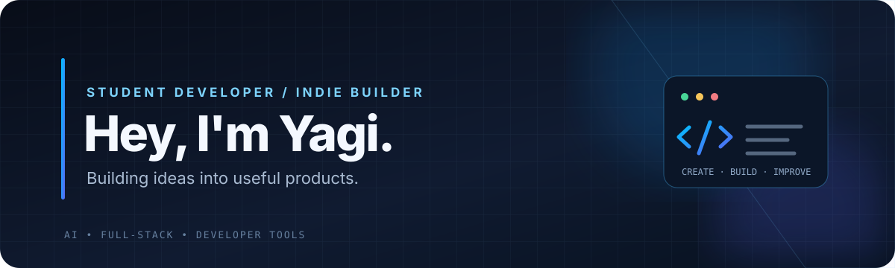

  
  

**Student Developer · Indie Builder · AI & Full-Stack Enthusiast**

*Curious by default. Building to learn. Shipping to improve.*

---

## About

I’m a student developer interested in turning ideas into useful software. I enjoy exploring how products work end-to-end — from interfaces and APIs to deployment and infrastructure.

- 🔭 Currently building and improving **REWIND**
- 🤖 Interested in AI applications, voice interfaces, and developer tools
- 🧩 Learning through real projects, experiments, and open-source work
- ⚙️ Enjoy working across frontend, backend, and deployment

## Selected Work

<table>
  <tr>
    <td width="50%" valign="top">
      <h3><a href="https://rewind.ggcart.in">REWIND</a></h3>
      
An AI-powered code repair platform that runs project checks and helps identify and fix code issues.

      
<a href="https://rewind.ggcart.in">Live app</a> · <a href="https://github.com/realyagi/rewind-repair-proof">Repository</a>

      AI · Developer tooling · Docker · Full-stack
    </td>
    <td width="50%" valign="top">
      <h3><a href="https://github.com/realyagi/karya">KARYA</a></h3>
      
A voice-first assistant exploring hands-free interaction, speech recognition, and useful AI workflows.

      
<a href="https://github.com/realyagi/karya">Explore the project</a>

      AI · Voice · TypeScript · Web
    </td>
  </tr>
  <tr>
    <td width="50%" valign="top">
      <h3><a href="https://github.com/realyagi/ggcart">GGCART</a></h3>
      
Part of my broader collection of experiments and products around web development and digital tools.

      
<a href="https://github.com/realyagi/ggcart">Explore the repository</a>

      Web · Product experiments
    </td>
    <td width="50%" valign="top">
      <h3><a href="https://github.com/realyagi/watchggcart">Watch GGCART</a></h3>
      
A media-platform project focused on building a video library and browsing experience.

      
<a href="https://github.com/realyagi/watchggcart">Explore the repository</a>

      Web · Media · Full-stack
    </td>
  </tr>
</table>

## Tech I Work With

  
  
  
  
  
  
  
  
  
  

## What I'm Exploring

- Building reliable AI-powered products
- Backend architecture, APIs, and databases
- Voice interfaces and workflow automation
- Deployment, containers, and infrastructure

## Find Me

- GitHub: [@realyagi](https://github.com/realyagi)
- REWIND: [rewind.ggcart.in](https://rewind.ggcart.in)

---

  Made with curiosity and a lot of iterations. Always learning, always building.

